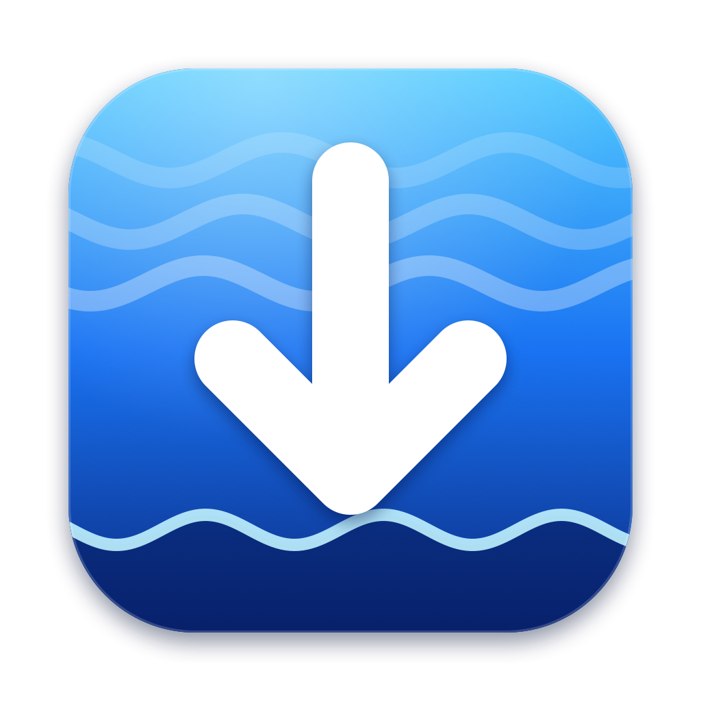
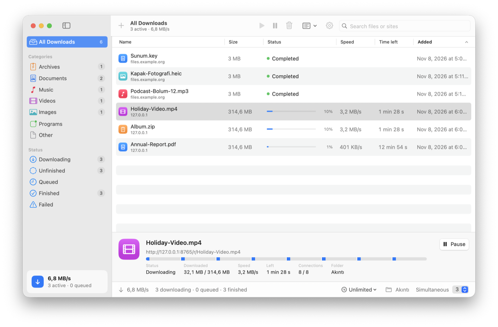
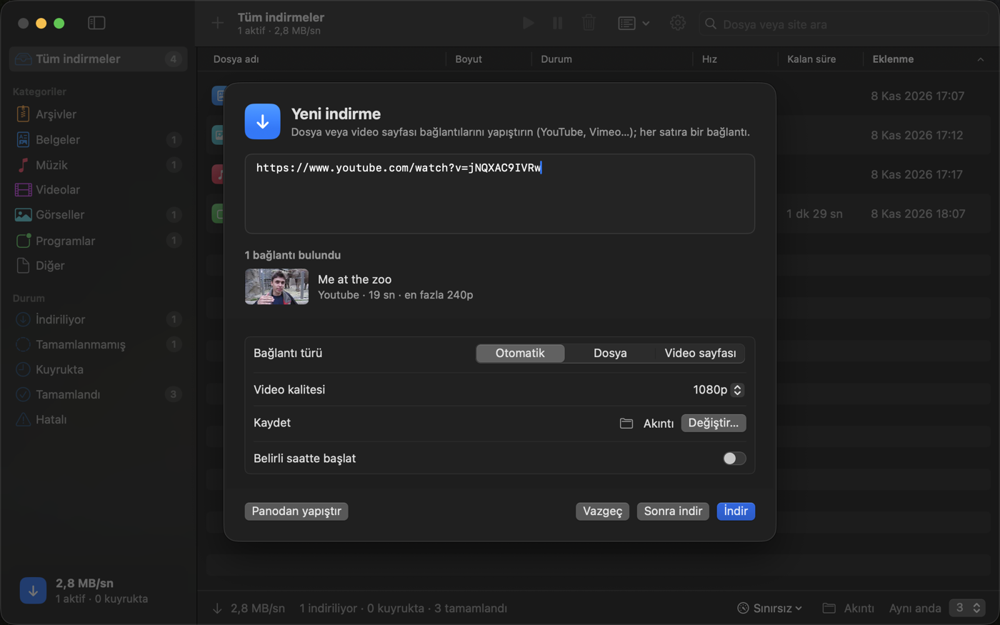
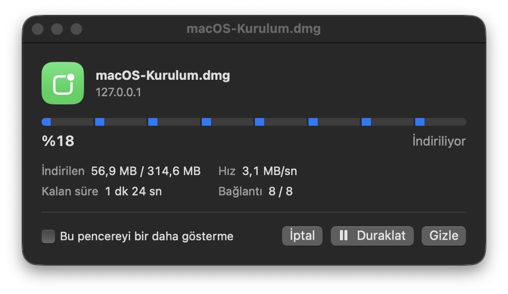

<p align="center"></p>

# Akıntı

<p>
  <a href="https://github.com/future01software/akinti/releases/latest"></a>
  <a href="https://github.com/future01software/akinti/actions/workflows/swift.yml"></a>
  
  <a href="LICENSE"></a>
</p>

[Türkçe](README.md) · **English**

**A free, open-source download manager for the Mac.** An IDM-style layout with a native macOS look (SwiftUI). Apple Silicon, macOS 14 or later. *Akıntı* means “current” (as in a stream) in Turkish.

- ⚡️ **Multi-connection downloads**: files are split into 8 parts downloaded at once; pause and resume where you left off
- 🎬 **YouTube and hundreds of video sites**: pick the quality, audio only (MP3/M4A), playlists
- 🧲 **Torrents and magnet links**: nothing extra to install
- 🧩 **Chrome extension** (Brave, Edge, Arc too): right-click “Download with Akıntı”, IDM-style download capture
- 📊 **Menu bar**: live speed, manage downloads from the menu bar
- 🔄 **Updates itself**, English/Turkish, light/dark; no ads, no tracking

<p align="center"></p>

| Video sites | Download window |
|---|---|
|  |  |

<sub>Video in the screenshot: <a href="https://peach.blender.org">Big Buck Bunny</a> © Blender Foundation, <a href="https://creativecommons.org/licenses/by/3.0/">CC BY 3.0</a>. Some screenshots show the Turkish interface; the app follows your Mac’s language (Settings → Language).</sub>

## Download

**[⬇︎ Download the latest version (Akinti-macOS.zip)](https://github.com/future01software/akinti/releases/latest/download/Akinti-macOS.zip)** · [All releases](https://github.com/future01software/akinti/releases) · [Changelog (Turkish)](CHANGELOG.md)

Unzip and move `Akıntı.app` to your Applications folder. Akıntı is not yet signed with an Apple Developer ID, so macOS warns you the first time: **right-click the app and choose Open** (or System Settings → Privacy & Security → **Open Anyway**). **No Homebrew needed:** torrent support is built in, and the components for video sites install with one click the first time you need them.

After that, Akıntı **updates itself**: Settings → Updates (checks once a day). Updates come from the GitHub releases, are verified with SHA-256, and Akıntı restarts with the new version; your downloads are kept.

## Features

### Fast, multi-connection downloads
If the server supports byte ranges (HTTP Range), the file is split into parts that download in parallel (8 by default, 1–16 in Settings). A segment bar shows each connection’s progress. Pausing — or quitting — saves where every part stopped, so resuming only fetches what’s missing. Servers without range support fall back to a single connection. Also: a queue with a limit on simultaneous downloads, scheduled start, automatic retries, a global speed limit, categories (archives, documents, music, video, images, programs, torrents), search, and an IDM-style download window that turns into “Download complete” when done.

### YouTube and video sites
Video pages are downloaded with [yt-dlp](https://github.com/yt-dlp/yt-dlp); high-quality video and audio are merged with [FFmpeg](https://ffmpeg.org). Paste a link and Akıntı shows the title, length and thumbnail; choose Best, 4K, 1080p, 720p, 480p or audio only. Playlists (YouTube lists, SoundCloud sets, Bandcamp albums) become one download per item. The first time, Akıntı installs both components with one click:
- **yt-dlp** comes from its official GitHub release and is verified against that release’s `SHA2-256SUMS`; it is checked for updates daily, because YouTube changes often.
- **FFmpeg** comes from [Martin Riedl’s Apple Silicon build](https://ffmpeg.martin-riedl.de) and is installed only if the developer’s Apple-notarized Developer ID signature checks out.

### Torrents and magnet links
Downloaded with a built-in [aria2](https://aria2.github.io). Paste a magnet link, drop a `.torrent` file on the window, use File → Open Torrent File… (⌘O), or click a magnet link in your browser (the add window opens first; nothing starts on its own). The details panel shows a piece map and seed/peer counts. Seeding after completion is optional (off by default).

### Browser extension (Chrome, Brave, Edge, Arc…)
- **Right-click → “Download with Akıntı”** on a link, video/audio, selected links or the page itself.
- **Toolbar button**: on a page like YouTube, “Download this video with Akıntı”.
- **Download capture**: zip, dmg, iso, mp4… downloads started in the browser go to Akıntı instead (file types, minimum size and excluded sites are configurable). If Akıntı can’t be reached, the browser keeps the download.

The extension talks to Akıntı through **Native Messaging** (no prompts). Every link is shown in Akıntı’s add window first — nothing downloads until you confirm. **Setup:** Akıntı → Settings → **Browser extension** → **Prepare extension** (places it in Documents → Akıntı Eklentisi); in your browser open `chrome://extensions`, turn on **Developer mode**, click **Load unpacked** and pick that folder.

### Menu bar
A menu bar icon shows the current speed; click it to pause or resume downloads, change the speed limit or add a link. Quitting from the Dock keeps Akıntı running in the menu bar; use **Quit Akıntı** in the menu bar panel or **⌘Q** to quit completely. Optional: run only in the menu bar, and open at login.

## Legal notice

Akıntı is a general-purpose tool; you are responsible for what you download.
- Only download from video sites (YouTube etc.) **your own content**, **openly licensed** content (e.g. Creative Commons), or content the rights holder allows you to download. Sites’ terms may prohibit downloading without permission.
- Only use torrents for content you **have the right to share** (e.g. Linux images, openly licensed files).
- Akıntı is not affiliated with YouTube, Google, Apple, Internet Download Manager (IDM) or any other product or company mentioned. Product names are trademarks of their owners.

## Privacy

Akıntı **collects no data**, needs no account, and has no ads or tracking. It connects to the internet only for downloads you add, the update check (once a day, `api.github.com`; can be turned off), and — when you choose to install them — downloading and updating components (`github.com`, `ffmpeg.martin-riedl.de`). History and settings stay on your Mac (`~/Library/Application Support/Akinti`). The browser extension collects nothing either; it only forwards links you send to Akıntı on your Mac.

## Building from source

```sh
swift run Akinti            # run
./scripts/bundle.sh         # build dist/Akinti-macOS.zip (unzip it somewhere to try the app)
swift test                  # tests (no internet needed)
cd Extension && npm test    # extension tests
```

New releases: add notes to `CHANGELOG.md`, then `git tag vX.Y.Z && git push origin vX.Y.Z`; GitHub Actions builds the app and publishes the release.

## License

Akıntı is MIT licensed. The bundled aria2 (GPL v2) and its libraries, and the components downloaded on first use, are listed with their licenses and source links in [Licenses/THIRD-PARTY.md](Licenses/THIRD-PARTY.md) (also in the app: Settings → Components → Licenses…).
