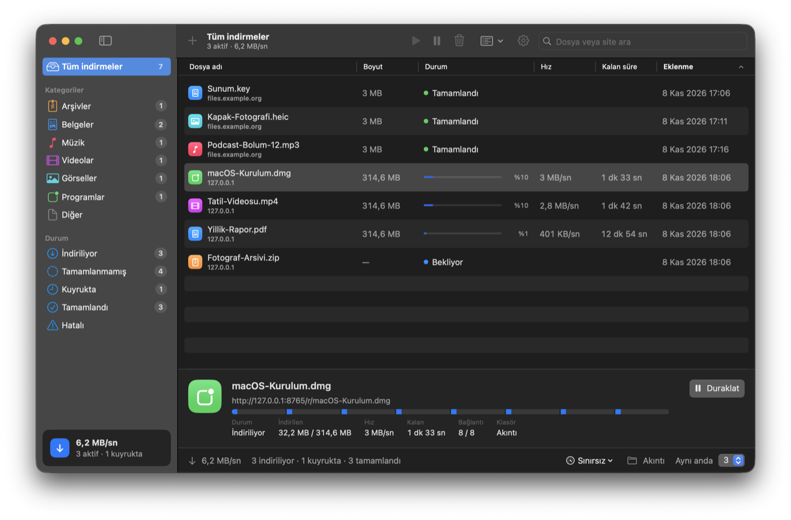
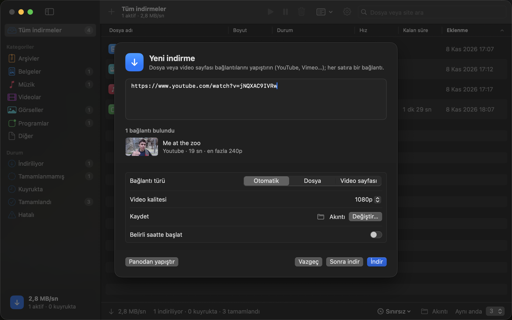
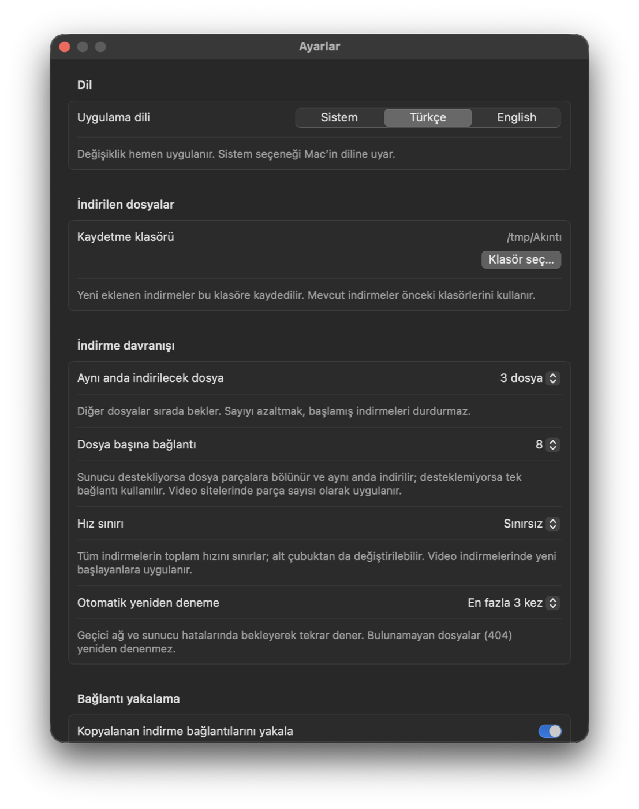
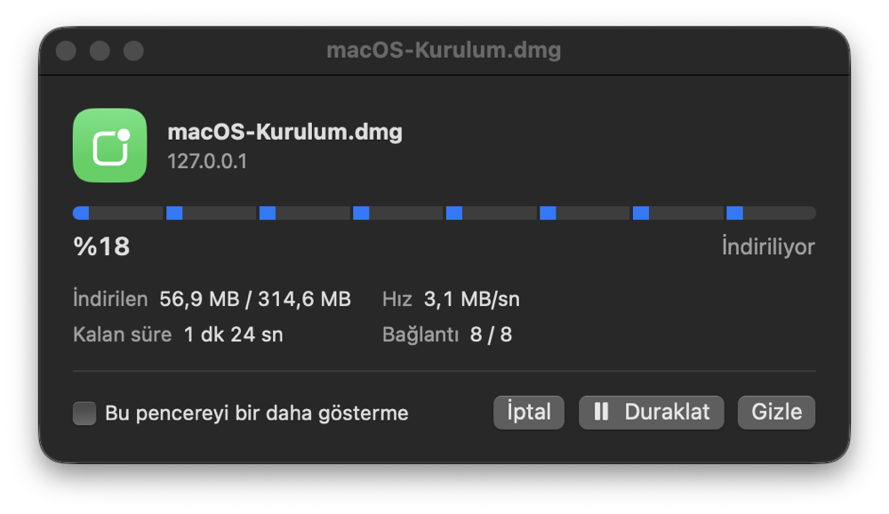
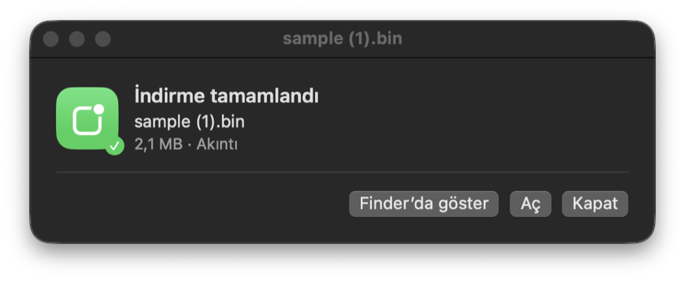
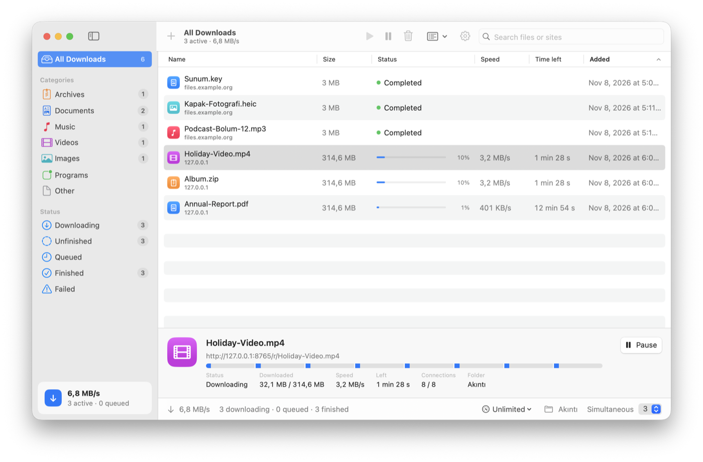
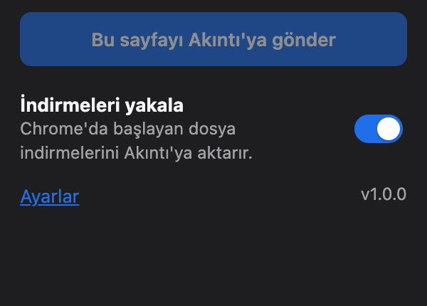
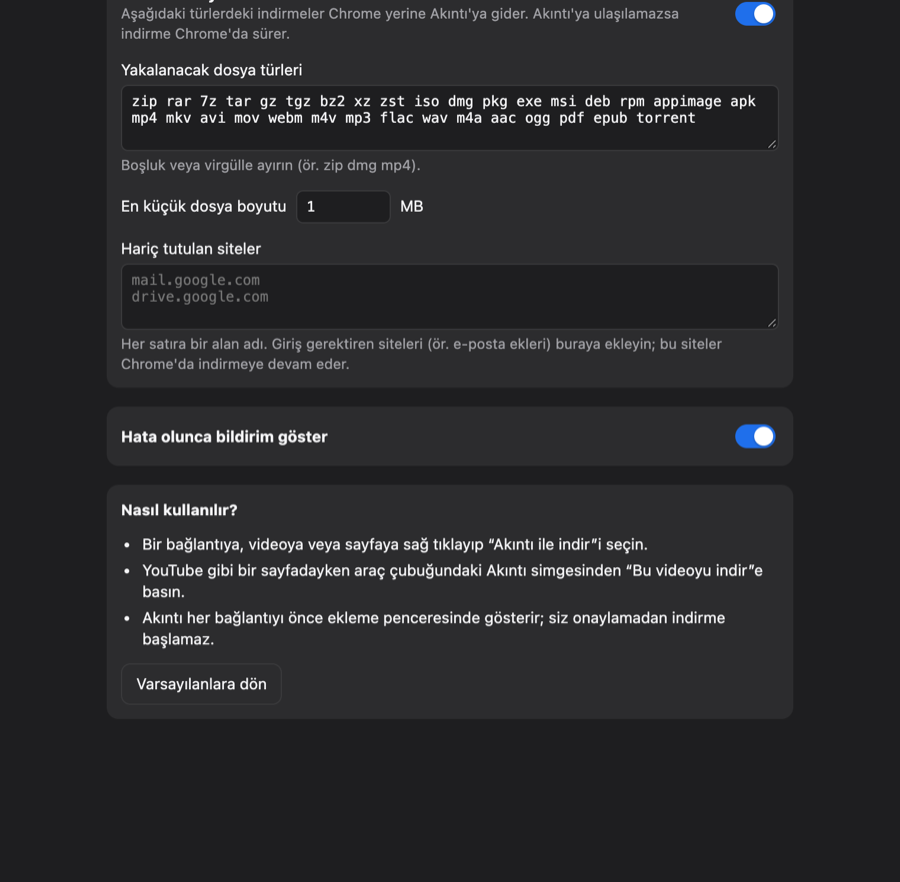

<p align="center"></p>

# Akıntı

<p>
  <a href="https://github.com/future01software/akinti/releases/latest"></a>
  <a href="https://github.com/future01software/akinti/actions/workflows/swift.yml"></a>
  
  <a href="LICENSE"></a>
</p>

**Türkçe** · [English](README.en.md)

**Mac için ücretsiz, açık kaynak indirme yöneticisi.** IDM düzeninde, macOS'un kendi görünümüyle (SwiftUI). Apple Silicon, macOS 14 veya üzeri.

- ⚡️ **Çok bağlantılı hızlı indirme**: dosya 8 parçaya bölünüp aynı anda iner; duraklat, kaldığı yerden sürdür
- 🎬 **YouTube ve yüzlerce video sitesi**: kalite seçimi, yalnızca ses (MP3/M4A), oynatma listeleri
- 🧲 **Torrent ve magnet**: kurulum gerektirmez
- 🧩 **Chrome eklentisi** (Brave, Edge, Arc): sağ tıkla “Akıntı ile indir”, IDM gibi indirme yakalama
- 📊 **Menü çubuğu**: anlık hız, indirmeleri üst bardan yönet
- 🔄 **Kendini günceller**, Türkçe/İngilizce, açık/koyu tema; reklam yok, veri toplamaz

<p align="center"></p>

| YouTube ve video siteleri | Ayarlar |
|---|---|
|  |  |

| İndirme penceresi | Tamamlandı |
|---|---|
|  |  |

<sub>Ekran görüntüsündeki video: <a href="https://peach.blender.org">Big Buck Bunny</a> © Blender Vakfı, <a href="https://creativecommons.org/licenses/by/3.0/">CC BY 3.0</a>.</sub>

<p align="center"><br><sub>İngilizce arayüz, açık tema</sub></p>

## İndir

**[⬇︎ En son sürümü indir (Akinti-macOS.zip)](https://github.com/future01software/akinti/releases/latest/download/Akinti-macOS.zip)** · [Tüm sürümler](https://github.com/future01software/akinti/releases) · [Değişiklik günlüğü](CHANGELOG.md)

Zip’i açıp `Akıntı.app`’i Programlar klasörüne taşıyın. Uygulama henüz Apple Developer ID ile imzalı olmadığından ilk açılışta macOS uyarı verir: uygulamaya **sağ tıklayıp Aç**’ı seçin (veya Sistem Ayarları → Gizlilik ve Güvenlik → **Yine de Aç**). **Homebrew gerekmez:** torrent desteği uygulamayla birlikte gelir; video siteleri için gereken bileşenler ilk kullanımda tek tıkla kurulur.

### Güncelleme

Akıntı yeni sürümleri kendisi bulur ve kurar: **Ayarlar → Güncellemeler** (günde bir kez otomatik denetler). Güncelleme GitHub sürümünden indirilir, SHA-256 ile doğrulanır; Akıntı kapanıp yeni sürümle açılır, indirmeler korunur.

## Çalıştırma

Swift araçları (Xcode veya Command Line Tools) kuruluysa:

```sh
swift run Akinti
```

Uygulama paketi oluşturmak için:

```sh
./scripts/bundle.sh
ditto -x -k dist/Akinti-macOS.zip /tmp/akinti-deneme-app && open /tmp/akinti-deneme-app/Akıntı.app
```

Paket yerel ad hoc imzalıdır; dağıtım için Developer ID imzası ve notarizasyon henüz yapılmamıştır.

## Çok bağlantılı hızlı indirme

Sunucu bayt aralıklarını (HTTP Range) destekliyorsa dosya parçalara bölünür ve her parça ayrı bir bağlantıyla aynı anda indirilir (varsayılan 8, ayarlardan 1–16). Ayrıntı panelindeki parçalı çubuk her bağlantının ilerlemesini gösterir. Duraklatınca veya uygulama kapanınca her parçanın kaldığı yer kaydedilir; devam edince yalnızca eksik kısımlar iner. Sunucu aralıkları desteklemiyorsa tek bağlantıya geçilir. Yarım dosyalar `~/Library/Application Support/Akinti/partial` içinde tutulur.

## Torrent ve magnet

Magnet bağlantıları ve `.torrent` dosyaları [aria2](https://aria2.github.io) ile indirilir; aria2 uygulamanın içinde gelir, ayrıca kurulum gerekmez. Magnet bağlantısını yapıştırın, `.torrent` dosyasını pencereye sürükleyin, **Dosya → Torrent dosyası aç… (⌘O)** kullanın ya da tarayıcıda magnet bağlantısına tıklayın (önce ekleme penceresi açılır, kendiliğinden indirme başlamaz). Torrentler kendi kategorisinde görünür; ayrıntı panelinde parça haritası ve kaynak/eş sayısı gösterilir. Duraklat/devam ve uygulama yeniden açıldığında kaldığı yerden sürme desteklenir. Bitince paylaşmaya devam etmek isteğe bağlıdır (Ayarlar → Torrent; varsayılan kapalı). aria2, Akıntı kapanınca kendiliğinden kapanır.

Yalnızca paylaşım hakkınız olan içerikleri indirin (ör. Linux kalıpları, açık lisanslı dosyalar).

## Hız sınırı

Alt çubuktaki hız göstergesinden veya Ayarlar’dan toplam hız sınırı seçilir (Sınırsız, 256 KB/sn … 25 MB/sn). Sınır tüm HTTP indirmelerine anında uygulanır; video indirmelerinde yeni başlayanlara yt-dlp’nin `--limit-rate` seçeneğiyle uygulanır.

## Video siteleri (YouTube, Vimeo…)

Video sayfası bağlantıları [yt-dlp](https://github.com/yt-dlp/yt-dlp) ile indirilir; yüksek kalitede görüntü ve ses [FFmpeg](https://ffmpeg.org) ile birleştirilir. İlk video bağlantısında Akıntı bu iki bileşeni **tek tıkla** kurar (yaklaşık 65 MB, Homebrew gerekmez):

- **yt-dlp** resmi GitHub sürümünden indirilir ve aynı sürümün `SHA2-256SUMS` dosyasıyla doğrulanır; YouTube sık değiştiği için günde bir kez güncellik denetlenir (Ayarlar → Bileşenler).
- **FFmpeg**, Apple Silicon için [Martin Riedl’in derlemesinden](https://ffmpeg.martin-riedl.de) indirilir; yalnızca geliştiricinin Apple onaylı Developer ID imzası doğrulanırsa kurulur.
- Bileşenler `~/Library/Application Support/Akinti/Tools` içine kurulur. Homebrew ile kurulmuş `yt-dlp`/`ffmpeg` varsa onlar da kullanılır.

Bağlantıyı yapıştırınca Akıntı başlığı, süreyi ve küçük resmi gösterir; kalite (En iyi, 4K, 1080p, 720p, 480p) veya yalnızca ses (M4A/MP3) seçilir. YouTube, Vimeo, Dailymotion, X, Instagram, TikTok, Twitch, SoundCloud gibi siteler otomatik tanınır; diğer siteler için ekleme penceresinde **Bağlantı türü → Video sayfası** seçilir. ffmpeg olmadan yüksek kalitede görüntü ve ses birleştirilemez (tek dosyalık sürüm indirilir). Duraklatılan video yeniden başlatıldığında yt-dlp yarım dosyadan devam eder.

**Oynatma listeleri:** YouTube listesi (`list=`), SoundCloud seti, Bandcamp albümü gibi bağlantılarda liste okunur ve her video listeye ayrı bir indirme olarak eklenir. Hem tek video hem liste içeren bağlantılarda (`watch?v=…&list=…`) “Oynatma listesinin tamamını indir” seçeneği çıkar.

Yalnızca indirme hakkınız olan içerikleri indirin; YouTube’un kullanım koşulları izinsiz indirmeyi genel olarak yasaklar.

## Arayüz

IDM düzeninde, macOS'un kendi bileşenleriyle: solda **kategoriler** (Arşivler, Belgeler, Müzik, Videolar, Görseller, Programlar, Diğer) ve **durum** grupları; ortada sıralanabilir sütunlu liste (Dosya adı, Boyut, Durum, Hız, Kalan süre, Eklenme); seçili indirme için alt ayrıntı paneli; altta toplam hız ve kuyruk özeti. Araç çubuğunda Ekle / Devam / Duraklat / Kaldır, kuyruk menüsü ve arama bulunur. Dock simgesinde aktif indirme sayısı görünür.

## Mevcut özellikler

- Gerçek HTTP/HTTPS dosya indirme, toplu bağlantı ekleme
- 1–8 eşzamanlı indirme ve kuyruk
- Duraklatma, devam etme ve elle yeniden deneme
- Tarih/saat ile planlama (uygulama açık ve Mac uyanık olmalı)
- Geçici ağ hataları ve HTTP 408/429/500/502/503/504 için artan bekleme süreleriyle otomatik yeniden deneme (varsayılan 3, ayarlardan 0–5)
- İlerleme ve aktarılan boyut gösterimi
- Kalıcı geçmiş, arama ve durum filtreleri
- Finder’da dosyayı gösterme, aynı adlı dosyaların üzerine yazmama
- Ayarlar ekranı: klasör seçimi, kalıcı eşzamanlı indirme sayısı, 0–5 otomatik tekrar ve sistem/açık/koyu tema
- Uygulama içi adım adım kullanım rehberi
- Kopyalanan dosya bağlantılarını yakalama (ayarlardan kapatılabilir) ve pencereye sürükle-bırak
- Anlık hız ve kalan süre, çoklu seçim, sağ tık menüsü, çift tıkla açma
- “Sonra indir” (duraklatılmış ekleme), kuyruktaki öğeleri duraklatma, tamamlananları temizleme
- Silerken dosyayı Çöp Sepeti’ne taşıma seçeneği (geri alınabilir)
- Türkçe / English dil seçeneği (Ayarlar → Dil)
- Kısayollar: ⌘N bağlantı ekle, ⇧⌘R tümünü başlat, ⇧⌘P tümünü duraklat, ⌫ seçileni kaldır

Varsayılan olarak dosyalar `~/Downloads/Akıntı` klasörüne, geçmiş `~/Library/Application Support/Akinti/downloads.json` dosyasına kaydedilir. Bağlantılar geçmişte tutulur; gizli bağlantıları paylaşmayın. Devam etme URLSession ve sunucu desteğine bağlıdır; desteklenmezse indirme baştan başlayabilir. Uygulamadan çıkarken aktif indirmeler sonlandırılır; sonraki açılışta elle devam ettirilir.

## Kullanım

1. **Bağlantı ekle** düğmesine basın. Web sayfası adresi yerine doğrudan dosya bağlantısını yapıştırın; her satıra bir bağlantı eklenebilir.
2. **İndir** düğmesine basın. İsterseniz **Belirli saatte başlat** seçeneğini açın.
3. Dosya satırındaki duraklat/oynat düğmeleri indirmeyi yönetir. Tamamlandıktan sonra klasör düğmesi dosyayı Finder’da gösterir.
4. Sol alttaki **Ayarlar**, üst araç çubuğundaki dişli veya **⌘,** kısayolu ile ayarları açın. Seçimler otomatik olarak `~/Library/Application Support/Akinti/settings.json` dosyasına kaydedilir. Klasör değişikliği yalnızca yeni eklenen indirmelere uygulanır. Eşzamanlı indirme sayısını azaltmak başlamış görevleri kesmez.
5. Sol alttaki **Nasıl kullanılır?** düğmesi uygulama içi rehberi açar.

Dağıtım arşivi `dist/Akinti-macOS.zip` dosyasıdır. Paket imzalanmadan önce geçici bir klasörde hazırlanır ve imzası doğrulanır; böylece Finder/bulut eşitleme metaverileri arşive girmez.

## Geliştirme planı

Sıradaki adımlar: Safari eklentisi, Apple Developer ID imzası ve onayı (ilk açılış uyarısını kaldırır), Chrome Web Store yayını, giriş gerektiren siteler için oturum/çerez desteği, indirme bitince yapılacaklar (Mac'i uyut, arşivi aç), bildirimler. Öneri ve hata bildirimleri için GitHub'da issue açabilirsiniz.

Kaynaklarda üçüncü taraf Swift bağımlılığı yoktur; video siteleri için isteğe bağlı olarak yt-dlp ve ffmpeg kullanılır. Katkılar ve hata bildirimleri GitHub üzerinden kabul edilir.

## Simge

`Assets/AppIcon.icns`, `scripts/make-icon.swift` ile çizilir (dalgalı mavi su yüzeyine inen indirme oku). Değiştirmek için betiği düzenleyip şunu çalıştırın, ardından `.icns` dosyasını `iconutil` ile yeniden üretin:

```sh
swift scripts/make-icon.swift Assets/AppIcon-1024.png
```

## Tarayıcı eklentisi (Chrome, Brave, Edge, Arc…)

Akıntı'nın Chrome eklentisi IDM'deki gibi çalışır:

- **Sağ tık → “Akıntı ile indir”**: bağlantı, video/ses, seçili metindeki bağlantılar veya sayfanın kendisi.
- **Araç çubuğu düğmesi**: YouTube gibi bir sayfadayken “Bu videoyu Akıntı ile indir”.
- **İndirme yakalama**: Chrome'da başlayan zip, dmg, iso, mp4… indirmeleri Akıntı'ya aktarılır (türler, en küçük boyut ve hariç tutulan siteler ayarlanabilir). Akıntı'ya ulaşılamazsa indirme Chrome'da sürer.
- Gönderilen her bağlantı Akıntı'nın ekleme penceresinde gösterilir; onaylamadan indirme başlamaz. Yönlendiren sayfa (Referer) ve tarayıcı kimliği aktarıldığı için bu bilgileri isteyen sunucular da çalışır.

Eklenti Akıntı ile **Native Messaging** üzerinden konuşur (açılır pencere çıkmaz): Akıntı açılınca uygulamanın içindeki küçük köprüyü (`akinti-bridge`) kurulu Chrome, Brave, Edge, Arc, Chromium ve Vivaldi'ye kaydeder; köprü yalnızca Akıntı eklentisinin kimliğine (`ojpoadglbpcggeknbppjmhmeajdeiklk`) yanıt verir.

**Kurulum:**
1. Akıntı → Ayarlar → **Tarayıcı eklentisi** → **Eklentiyi hazırla**. Eklenti **Belgeler → Akıntı Eklentisi** klasörüne konur.
2. Tarayıcıda `chrome://extensions` adresini açın (Ayarlar'daki **Chrome'da eklentileri aç** düğmesi de açar) ve sağ üstten **Geliştirici modu**'nu açın.
3. **Paketlenmemiş öğe yükle** → soldan **Belgeler** → **Akıntı Eklentisi** → **Seç**.

Klasörü silmeyin: Akıntı güncellendikçe eklenti de kendiliğinden güncellenir. Eklenti ayrıca her sürümde `Akinti-Chrome-Extension.zip` olarak yayınlanır.

<p align="center"> &nbsp; </p>

## Menü çubuğu

Akıntı menü çubuğunda (üst bar) bir simge gösterir; indirme sürerken yanında anlık hız yazar. Simgeye tıklayınca aktif indirmeleri duraklatıp sürdürebilir, hız sınırını değiştirebilir, yeni bağlantı ekleyebilirsiniz. Ayarlar → Menü çubuğu ve başlangıç bölümünden simge gizlenebilir, **yalnızca menü çubuğunda çalışma** (pencere kapanınca Dock simgesi gizlenir) ve **Mac açılınca başlatma** açılabilir. Dock’tan “Çık” denince Akıntı kapanmaz, menü çubuğunda çalışmaya devam eder; tamamen kapatmak için menü çubuğundaki **Akıntı’dan çık** ya da **⌘Q** kullanın (Ayarlar’dan değiştirilebilir). Bartender, Barbee gibi menü çubuğu düzenleyiciler yeni simgeleri gizli bölüme koyabilir; simgeyi görünür bölüme sürükleyin.

## İndirme penceresi

IDM’deki gibi, bir indirme başlayınca küçük bir pencere açılır: parçalı ilerleme çubuğu, hız, kalan süre, bağlantı sayısı ve Duraklat/İptal düğmeleri. İndirme bitince pencere “İndirme tamamlandı” ekranına döner (Aç, Finder’da göster). Bir seferde 3’ten fazla indirme eklenirse (ör. oynatma listesi) açılmaz. Ayarlar’dan veya penceredeki “Bu pencereyi bir daha gösterme” kutusundan kapatılabilir.

## Yeni sürüm yayınlama

Sürüm numarası git etiketinden gelir. Önce değişiklikleri [CHANGELOG.md](CHANGELOG.md) içinde **Yayınlanmamış** başlığının altına yazın ve başlığı `## [0.7.0] - tarih` biçiminde yeni sürüme çevirin; GitHub sürüm notları bu bölümden oluşturulur. Ardından:

```sh
git tag v0.7.0
git push origin v0.7.0
```

GitHub Actions testleri çalıştırır, uygulamayı paketler ve sürümü **aynı dosya adıyla** (`Akinti-macOS.zip`) yayınlar; yukarıdaki “En son sürümü indir” bağlantısı her zaman en yeni sürümü indirir.

## Geliştirici seçenekleri

Gerçek geçmişe ve ayarlara dokunmadan denemek için uygulama Terminal’den şu seçeneklerle açılabilir:

```sh
open -n /tmp/akinti-deneme-app/Akıntı.app --args --state-dir /tmp/akinti-deneme --add https://example.org/dosya.zip --select-first --open-settings
```

## Yasal uyarı

Akıntı, içerik indirmek için kullanılan genel amaçlı bir araçtır; neyi indirdiğinizden siz sorumlusunuz.

- Video sitelerinden (YouTube vb.) yalnızca **kendi içeriklerinizi**, **açık lisanslı** (ör. Creative Commons) içerikleri veya hak sahibinin indirmeye izin verdiği içerikleri indirin. Sitelerin kullanım koşulları izinsiz indirmeyi yasaklayabilir.
- Torrenti yalnızca **paylaşım hakkı olan** içerikler (ör. Linux kalıpları, açık lisanslı dosyalar) için kullanın.
- Akıntı; YouTube, Google, Apple, IDM (Internet Download Manager) veya adı geçen diğer ürün ve şirketlerle bağlantılı değildir. Ürün adları sahiplerinin markalarıdır.

## Gizlilik

Akıntı **hiçbir veri toplamaz**, hesap istemez, reklam veya izleme içermez. İnternete yalnızca şunlar için bağlanır:

- sizin eklediğiniz indirmeler;
- güncelleme denetimi (günde bir kez, `api.github.com`; Ayarlar'dan kapatılabilir);
- siz kurmak isteyince bileşenlerin indirilmesi ve yt-dlp'nin güncelliğinin denetlenmesi (`github.com`, `ffmpeg.martin-riedl.de`).

Geçmiş ve ayarlar yalnızca Mac'inizde (`~/Library/Application Support/Akinti`) tutulur. Tarayıcı eklentisi de veri toplamaz; yalnızca sizin gönderdiğiniz bağlantıları Mac'teki Akıntı'ya iletir.

## Lisanslar

Akıntı MIT lisanslıdır. Uygulamayla birlikte gelen aria2 (GPL v2) ve kütüphaneleri ile ilk kullanımda indirilen bileşenlerin lisansları ve kaynak kodu bağlantıları [Licenses/THIRD-PARTY.md](Licenses/THIRD-PARTY.md) dosyasındadır; uygulamada Ayarlar → Bileşenler → **Lisanslar…** ile açılır.

## Testler

`swift test` internet gerektirmeden gerçek indirmeler yapar: yerel HTTP sunucusuyla çok bağlantılı indirme, duraklat/devam ve hız sınırı; sahte bir yt-dlp ile video akışı; yerel tracker ve paylaşımcıyla gerçek torrent aktarımı; bileşen kurulumunda SHA-256 ve imza doğrulaması; tarayıcı köprüsü. Eklentinin karar fonksiyonları Node ile sınanır (`cd Extension && npm test`). GitHub Actions her gönderimde ikisini de çalıştırır ve uygulamayı paketler.
